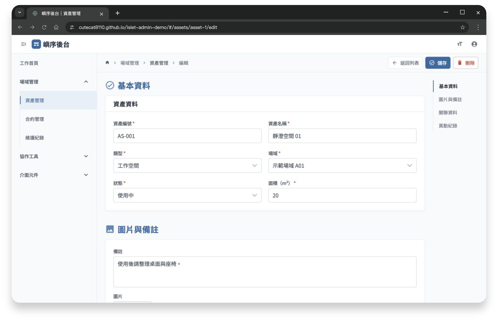
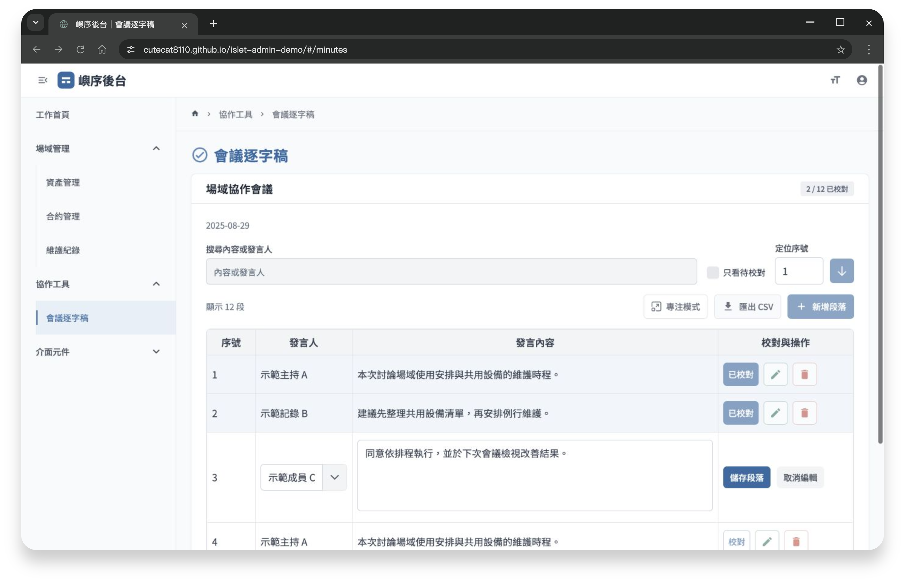
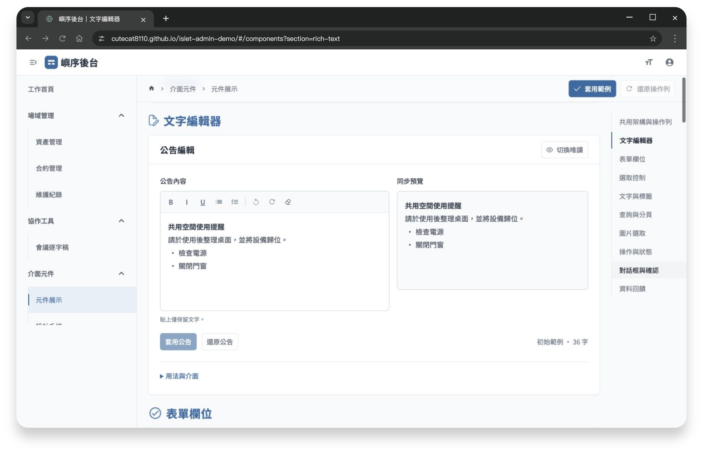
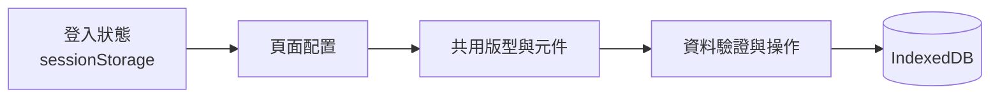

# 嶼序後台｜後台系統與共用架構展示

`Vue 3` · `TypeScript` · `PrimeVue 4` · `Vite` · `Quill 2`

以共用版型、操作列與長表單，串起資產、合約及維護流程。

**[開啟 Demo](https://cutecat8110.github.io/islet-admin-demo/)** · [元件展示](https://cutecat8110.github.io/islet-admin-demo/#/components) · [設計系統](https://cutecat8110.github.io/islet-admin-demo/#/design-system)

| 入口 | 代表操作 |
| --- | --- |
| [共用操作列](https://cutecat8110.github.io/islet-admin-demo/#/components?section=architecture) | 編輯、唯讀、處理中配置；手機「更多功能」 |
| [資產長表單](https://cutecat8110.github.io/islet-admin-demo/#/assets/asset-1/edit) | 分區目錄、驗證、圖片及關聯資料 |
| [逐字稿](https://cutecat8110.github.io/islet-admin-demo/#/minutes) | 搜尋定位、列內編輯、段落新增及校對鎖定 |
| [文字編輯器](https://cutecat8110.github.io/islet-admin-demo/#/components?section=rich-text) | 格式、復原重做、同步預覽與空白驗證 |

**試用：** 選角色帶入帳密 → 編輯資產 → 校對逐字稿 → 試用共用元件。

逐字稿與文字編輯器

共用架構

Vue Router 管理頁面與離頁提醒；編輯器按需載入。

角色與使用說明

管理員可管理資料及校對；編輯者可編修，不提供校對；唯讀可查詢、檢視與匯出。

品牌與資料為虛構，權限由瀏覽器模擬。修改與圖片保存在目前瀏覽器；元件範例離頁清除，已存查詢條件除外。「重設資料」恢復初始內容並登出，不影響其他作品。

